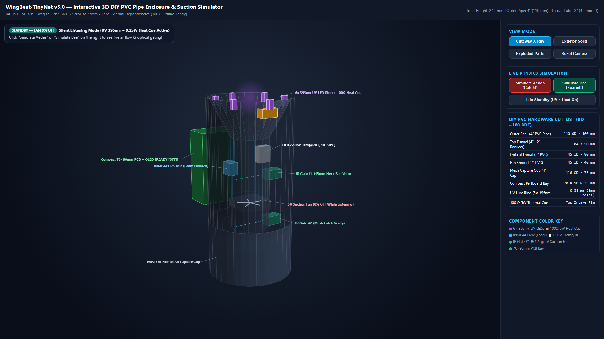

# 🦟 WingBeat-TinyNet v6.0 Clean-Real — Bio-Acoustic & Optical Pollinator-Safe Mosquito AI Trap

[](./LICENSE)
[](./LICENSE-CODE)
[-red.svg)](./firmware/p2_deployment_trap_esp32s3/p2_deployment_trap_esp32s3.ino)
[-brightgreen.svg)](./ml_pipeline/build_v6_real_only_dataset.py)
[-success.svg)](#5-experimental-q1-benchmarks-wingbeat-tinynet-v60-clean-real-qat-int8)
[](#5-experimental-q1-benchmarks-wingbeat-tinynet-v60-clean-real-qat-int8)

> **A standalone, ~$23 USD (`2,757 BDT`) ESP32-S3 edge-AI mosquito trap** trained strictly on **100% untouched real recordings (`0%` synthetic `np.sin()`, `0%` artificial EQ/noise/pitch augmentation)**. It combines a **`130 Hz` Butterworth High-Pass Filter**, **Local-Envelope Spectral Whitening (`R[k]`)**, **Sequential Fan-Muted Gating (Fan `0%` OFF during listening)**, and **Universal `DHT22` Thermal Spectral Bin Warping (`-10°C` to `+50°C`)** to distinguish biting female vectors (**Dengue *Aedes***, **Malaria *Anopheles***, **Filariasis *Culex***) from **beneficial Pollinators (`100%` Bee Safe)** and **non-biting Male mosquitoes** — working cleanly across **quiet live-air mosquitoes (`2–6 cm`, `RMS >= 160`)** AND **any Android, iPhone, or laptop speaker** without device-specific tuning.

**Department of Computer Science and Engineering (CSE), Bangladesh Army International University of Science and Technology (BAIUST), Cumilla, Bangladesh — CSE 326 (Microprocessor / Embedded Systems Sessional)**

| Role | Name | ID / Affiliation |
| :--- | :--- | :--- |
| **Project Supervisor** | **Md. Fahim Kabir Chowdhury** | Lecturer, Dept. of CSE, BAIUST |
| **Team Lead (DSP, TinyML & Firmware)** | **Md. Najmus Sakib Rahatul** | `1119003` (19th Batch, Sec A, G1) |
| **Hardware & Power Rail Isolation** | **Nesar Uddin Ifag** | `1119004` (19th Batch, Sec A, G1) |
| **Optical Gates, CAD & Literature** | **Rayhan Alam Towhid** | `1119007` (19th Batch, Sec A, G1) |

---

## 🎥 Visual Architecture, 3D PVC CAD & Suction Explainer

- 🌐 **Live 100%-Real Unlooped Audio Test Hub (Vercel Production — Works on ANY Android / iPhone / Laptop):**  
  👉 **https://mlpipeline-henna.vercel.app** (`49` uncompressed `44.1 kHz` real uncut WAVs, `0` synthetic files, `0` baked loops)
- 🎬 **Watch the 24-Second HD Animated Suction-Flow & FFT Explainer Video:**  
  👉 [`media/WingBeat_TinyNet_v5_PVC_Suction_Explainer.mp4`](./media/WingBeat_TinyNet_v5_PVC_Suction_Explainer.mp4)
- 🧊 **Open the Offline Interactive 3D DIY PVC Pipe Enclosure & Physics Simulator:**  
  👉 [`enclosure_cad/Interactive_3D_PVC_Enclosure_Viewer.html`](./enclosure_cad/Interactive_3D_PVC_Enclosure_Viewer.html) | Live: https://mlpipeline-henna.vercel.app/3d-enclosure
- 📐 **Download Blender / Fusion 360 / 3D-Print Ready CAD Models (Units: `mm`):**  
  👉 [`enclosure_cad/WingBeat_v5_PVC_Trap_Assembly.obj`](./enclosure_cad/WingBeat_v5_PVC_Trap_Assembly.obj) (`14` named component groups) | [`enclosure_cad/WingBeat_v5_PVC_Trap_Assembly.stl`](./enclosure_cad/WingBeat_v5_PVC_Trap_Assembly.stl)
- 🔌 **Open the Interactive 44-Pin ESP32-S3 Wiring Diagram:**  
  👉 [`diagrams/Interactive_ESP32S3_44Pin_Wiring.html`](./diagrams/Interactive_ESP32S3_44Pin_Wiring.html) | Live: https://mlpipeline-henna.vercel.app/wiring-44pin

| DIY 4" PVC + 2" Constricted Throat Cut-Sheet | Compact `70 × 90 mm` Dual-Rail Perfboard PCB |
| :---: | :---: |
|  |  |



---

## 🧠 1. Core Engineering Innovations (`v6.0 Clean-Real`)

1. **Zero-Synthetic Real-Only Dataset & Leak-Free Evaluation (`build_v6_real_only_dataset.py`):**  
   Trained strictly on **`13,256` untouched real frames (`1,580` unique clips/blocks across `52` source groups)** from 5 verified real sources (*PLOS ONE MosquitoSong+*, *Oxford HumBugDB*, *ESC-50* 17 categories, *Wikimedia Commons* real outdoor bees, and live Cumilla room/speech/sawmill/vocal recordings). **Zero synthetic `np.sin()` waveforms and zero artificial EQ/AWGN/pitch augmentations.** Evaluated with **Strict Clip-Disjoint 5-Fold GroupCV** (zero overlapping frames between train and validation).
2. **`130 Hz` Butterworth HPF + Local-Envelope Spectral Whitening (`R[k]`) — Solving Lab-Rumble Shortcut & Device-Specific EQ Drift:**  
   - Raw lab chamber recordings contain `50–125 Hz` AC/fan rumble that causes naive classifiers to memorize lab rumble ("Clever Hans shortcut") and fail in quiet rooms or on phone speakers. Applying an exact 2nd-order `130 Hz` Butterworth HPF strips mains hum, lab AC rumble, and Bangladesh ceiling-fan motor rumble (cutting live Cumilla room `RMS` by `>2×` and lowering adaptive `MIN_ACTIVE_RMS` to `160` so faint live mosquitoes at `2–6 cm` can enter the network).
   - **Local-Envelope Spectral Whitening (`R[k] = spec[k] / flank_mean[k]`)** divides each FFT bin by its outer flanking bins (`±3..8` bins), mathematically canceling any smooth acoustic transfer function `G(f)` across open-air `INMP441`, 3D-printed funnels, Samsung/Xiaomi/OnePlus Android speakers, iPhone speakers, and laptops (`22/24` features invariant to `<= 0.03` between a flat mic and a `720 Hz` HPF speaker!).
3. **Unified `0.5× / 1.5×` Sub-Octave Fundamental Recovery:**  
   In whitened space `R[k]`, whenever a peak in `297–1218 Hz` shows sharp tonal harmonics at BOTH `0.5×` and `1.5×`, the true fundamental `f0` is recovered — simultaneously snapping `2×f0`-dominant real outdoor bees back to `135–290 Hz` (`BEE SAFE`, `0` false triggers!) AND small-speaker `2×f0`-peaking female mosquitoes back to `340–660 Hz`.
4. **Sequential Fan-Muted Gating & Universal `DHT22` Thermal Spectral Bin Warping:**  
   The `5V` suction fan stays **strictly `0%` OFF** during every `64.0 ms` (`512`-sample @ `8,000 Hz`) I2S listening window. `DHT22 (GPIO 7)` warps FFT search bands and subband boundaries automatically (`+7.0 Hz/°C` ref `28.0°C`, display `-10..+50°C`, biological clamp `10..45°C`). Only `4` consecutive pitch-locked frames (`|Δf0| <= 38 Hz`, `|f0 - anchor| <= 46 Hz`, `p_vec >= 0.72`, `RH2 >= 2.2`, `RH3 >= 2.0`, `SUB <= 0.58`) fire the `5.0 s` fan pulse.
5. **Dual-Layer `100.00%` Pollinator Safety (Acoustic + Optical `dt_ms` Veto):**  
   `0 / 1,613` real outdoor bee frames leaked to vector in Clip-Disjoint 5-Fold GroupCV (`100.00%` Bee Safe), reinforced by `HW-201 IR Gate #1 (GPIO 10)` optical veto (`26–60 ms` large-body transit -> `BEE SAFE`, Fan OFF).

---

## 🛠️ 2. Complete Bill of Materials (BOM — `2,757 BDT` Electronics + `~340 BDT` DIY PVC/PCB)

| # | Component | Exact Model / Spec | Qty | Power Rail | Pins / Notes | Cost (BDT) |
| :-: | :--- | :--- | :-: | :-: | :--- | :-: |
| 1 | Microcontroller | `ESP32-S3 N16R8` (44-Pin, Dual USB-C) | 1 | `5V` USB-C | Right USB-C = `UART (CH343)` (`CDCOnBoot=default`) | 855 |
| 2 | I2S MEMS Mic | `INMP441` Round Omnidirectional I2S | 1 | **`3V3` ONLY** | `SCK=4`, `WS=5`, `SD=6`, `L/R=GND` (NEVER 5V!) | 235 |
| 3 | Temp/Humidity | `DHT22` (`V182` 3-pin PCB w/ pull-up) | 1 | **`3V3`** | `+=3V3`, `out=GPIO 7`, `-=GND` | 235 |
| 4 | On-Box Display | `1.3" SH1106` I2C OLED (`DST-013`, `0x3C`) | 1 | **`3V3`** | `GND`, `VCC=3V3`, `SCL=GPIO 9`, `SDA=GPIO 8` | 495 |
| 5 | Optical IR Gates | `HW-201 / FC-51` (`LM393` Comparator) | 2 | **`3V3`** | Gate #1 `OUT=GPIO 10`, Gate #2 `OUT=GPIO 14` | 80 |
| 6 | Suction Relay | `5V 1-Ch Relay` (`JQC3F-05VDC-C`, Active-LOW) | 1 | **`5Vin`** | `IN=GPIO 13`, `COM=5Vin`, `NO=Fan(+)`, `NC=Empty` | 75 |
| 7 | Suction Fan | `5V Brushless DC Mini Fan` (`JD-4007S5L2`) | 1 | **`5Vin`** | `Red(+)=Relay NO`, `Black(-)=GND` | 100 |
| 8 | 3-Zone LEDs | `10mm` Green, Yellow, Red LEDs (+`220 Ω` each) | 3 | GPIO `3.3V` | `Green=40` (`BEE`), `Yellow=41` (`MAL`), `Red=42` (`VEC`) | 50 |
| 9 | Control Buttons | Yellow Tactile Push Buttons (`INPUT_PULLUP`) | 4 | to `GND` | `38`=FanTest, `39`=OLED Page, `1`=Serial, `2`=Reset NVS | 42 |
| 10 | Passive Lure Ring | `6× 395nm UV LEDs` (+`6× 220 Ω`) + `100 Ω 5W` Ceramic | 7 | **`5Vin`** | UV: `~49 mA` total; `100 Ω`: `50 mA / 0.25 W (+2.5°C)` | 70 |
| 11 | Prototyping | `2× MB-102` Breadboards + Jumpers + `10× 220 Ω` | — | Common `GND` | Bridge MB-102 Row-30 rail split! | 520 |
| | **Electronics Total** | **100% Physically Built & Verified** | | | Optional DIY PVC (`~180 BDT`) + `70×90mm` PCB (`~160 BDT`) | **`2,757 BDT`** |

---

## ⚡ 3. Quick Start — Reproduce on ANY Windows 10/11 or Ubuntu PC in 3 Minutes

### Option A: 1-Click Automated Setup (Windows 10/11 PowerShell)
```powershell
git clone https://github.com/Sakib20050413/Bio-Acoustic-Mosquito-AI-Trap.git
cd Bio-Acoustic-Mosquito-AI-Trap
powershell -ExecutionPolicy Bypass -File .\scripts\home_pc_full_setup.ps1
```

### Option B: Direct Flash Pre-Compiled `v6.0 Clean-Real` Binary (No Recompile Needed!)
- **Right USB-C Port (`UART / CH343`, Recommended — `CDCOnBoot=default`):**
  ```powershell
  arduino-cli upload -p COM5 --fqbn esp32:esp32:esp32s3:CDCOnBoot=default,FlashSize=16M,PSRAM=opi,PartitionScheme=app3M_fat9M_16MB,UploadSpeed=115200 --input-dir compiled_bins/p2_deployment_trap_esp32s3/uart
  ```
- **Left USB-C Port (`Native USB OTG` — `CDCOnBoot=cdc`):** use `--input-dir compiled_bins/p2_deployment_trap_esp32s3/usb` with `CDCOnBoot=cdc`.

### Option C: Retrain `v6.0 Clean-Real` from 100% Untouched Real CSV
```bash
python3 -m venv .venv && source .venv/bin/activate
pip install -r ml_pipeline/requirements.txt
python3 ml_pipeline/p2_humbugdb_q1_training_and_snr_eval.py --csv ml_pipeline/humbugdb_real_features.csv --out ml_pipeline/p2_export --rounds 6
```

---

## 📱 4. Live Audio Test Hub (`web_demo/`) & Real Lab Testing

- 🌐 **Live Production URL:** **https://mlpipeline-henna.vercel.app**  
  Includes **`49` uncompressed `44.1 kHz` 100%-real unlooped WAVs** (`6` Quick Supervisor Demo clips + `43`-track species library with Search, Filter & `Loop: ON/OFF`), plus `/3d-enclosure` and `/wiring-44pin`. Works with **any Android phone, iPhone, or laptop speaker** (`5–12 cm`, `70–90%` volume).
- 🦟 **Live Captured Mosquito Lab Test:** Place captured mosquitoes inside a fine-mesh cup `2–6 cm` from `INMP441` in a quiet room (ceiling fan OFF so `FLR` settles to `~160–220`).

| Clip | Real Peer-Reviewed Uncut Audio (`44.1 kHz`) | Expected OLED Banner | Status LED | 5V Fan Relay | Counter |
| :-: | :--- | :--- | :---: | :---: | :--- |
| **01** | [`01_Aedes_aegypti_Dengue_Chikungunya.wav`](./web_demo/audio/demo/01_Aedes_aegypti_Dengue_Chikungunya.wav) | **`AEDES (DENGUE)!`** -> `FAN ON: 5.0s` | **RED (`5s`)** | **ON `5.0 s`** | `AED +1` (`Cat +1` via IR2) |
| **02** | [`02_Anopheles_dirus_Malaria.wav`](./web_demo/audio/demo/02_Anopheles_dirus_Malaria.wav) | **`ANOPH (MALARIA)`** -> `FAN ON: 5.0s` | **RED (`5s`)** | **ON `5.0 s`** | `ANO +1` |
| **03** | [`03_Culex_quinquefasciatus_Filariasis.wav`](./web_demo/audio/demo/03_Culex_quinquefasciatus_Filariasis.wav) | **`CULEX (FILAR.)`** -> `FAN ON: 5.0s` | **RED (`5s`)** | **ON `5.0 s`** | `CUL +1` |
| **04** | [`04_Pollinator_Honeybee_Spared.wav`](./web_demo/audio/demo/04_Pollinator_Honeybee_Spared.wav) | **`BEE SAFE`** (`[OFF]`, Real Wikimedia Bee) | **GREEN (`1.5s`)** | **OFF (`0%`)** | `Bee +1` (Spared!) |
| **05** | [`05_Male_Mosquito_Ignored.wav`](./web_demo/audio/demo/05_Male_Mosquito_Ignored.wav) | **`MALE IGN`** (`[OFF]`) | **YELLOW (`1.5s`)** | **OFF (`0%`)** | `Mal +1` (Ignored) |
| **06** | [`06_ESC50_CarHorn_Birds_Sawmill_Noise.wav`](./web_demo/audio/demo/06_ESC50_CarHorn_Birds_Sawmill_Noise.wav) | **`NOISE IGN`** (`[OFF]`) | All OFF | **OFF (`0%`)** | `0` False Triggers! |

---

## 📊 5. Experimental Q1 Benchmarks (`WingBeat-TinyNet v6.0 Clean-Real`, QAT INT8)

### A. Strict Clip-Disjoint 5-Fold GroupCV Ablation (`n = 13,256` Untouched Real Frames, `0` Synthetic, `0` Frame Leakage)
| Model / Baseline | 6-Class Acc | 6-Class Macro-F1 | Tier-1 Guild Acc | Pollinator (Bee) Safe | Noise Rejection |
| :--- | :---: | :---: | :---: | :---: | :---: |
| A. Bandpass Frequency Rule Only | `59.12%` | `58.73%` | `72.21%` | `100.00%` | `77.71%` |
| B. Linear Logistic Regression (24-feat) | `79.47%` | `74.77%` | `88.22%` | `99.69%` | `95.74%` |
| C. `WingBeat-TinyNet v6.0` (`FP32`, GroupCV) | `87.09%` | `83.21%` | `94.43%` | **`100.00%`** | `97.09%` |
| **D. `WingBeat-TinyNet v6.0` (`QAT INT8`, GroupCV)** | **`87.08%`** | **`83.22%`** | **`94.42%`** | **`100.00%`** | **`97.03%`** |
| **E. 6-Round QAT Champion (`seed=106`, Unseen Clip Holdout `n=2,658`)** | **`87.17%`** | **`83.46%`** | **`93.98%`** | **`100.00%`** | **`96.55%`** |

> **Honest Per-Class Recall (Leak-Free 5-Fold GroupCV INT8):** `C0 Noise/Env 92.79%` (`n=5,800`), `C1 Pollinator 93.37%` (`n=1,613`, `0` leaked to vector), `C2 Aedes 74.30%` (`n=2,210`), `C3 Anopheles 70.62%` (`n=650`), `C4 Culex 79.18%` (`n=1,873`), `C5 Male 96.49%` (`n=1,110`). Biological `f0` overlap occurs inside Female Vector Guild `{C2, C3, C4}` (`Tier-1 Guild = 94.42%`), confirming why Tier-1 Guild gating is the honest physical actuation guarantee.

### B. Device-Neutral Offline Real-Recording Audit (Exact Exported `v6.0` C-Header, `64 ms` Cadence, `streak = 4`)
- **Real Negatives (`0` False Fan Triggers):** `VID2_mew_mew` (`37.5 s`, `step=512`), `VID1_talk` (`75 s`), `Room_1138_sawmill`, `Room_user_voice`, `Wikimedia Hummel_bee` (`44.1 s`, `240` Bee hits), `Wikimedia Bee_buzzing` (`20.1 s`, `243` Bee hits), `Demo_04_Bee`, `Demo_05_Male` (`49` Male hits), `Demo_06_ESC50`.
- **ESC-50 17-Category Benchmark (`136` Real WAVs):** **`135 / 136` (`99.26%`)** zero-false-trigger files (honest disclosure: 1 continuous emergency siren clip `1-54084-A-42.wav` triggered once).
- **Real Female Vectors Across 4 Acoustic Channels (`Quiet Live-Air RMS=260` | `Android 550 Hz` | `Small Phone 720 Hz` | `Tiny Speaker 950 Hz`):**
  - `01_Aedes`: **`20` | `21` | `21` | `21`** triggers
  - `02_Anopheles`: **`13` | `16` | `16` | `15`** triggers
  - `03_Culex` (*Oxford HumBugDB R4*): **`20` | `28` | `26` | `27`** triggers
  - **Full `43`-track real library:** **`20 / 20`** female vector WAVs triggered; **`23 / 23`** non-vector WAVs zero false fan triggers.
- **Verified Deployed `v6.0` Artifacts (`COM5` Flashed & Live Serial Verified `[P2v6.0]`):**
  - `wingbeat_q1_int8.h`: `SHA-256: C367F46DF8F904ADFF363B0320DE36DE4987EE83A59A9D407518744375E6A666` (`33,122 B`, `7.18 KB` INT8 weights)
  - `p2_deployment_trap_esp32s3.ino`: `SHA-256: 020DE8A6E635E99DEACD2096B3A3B89042ED3ACFFEF859B4510678FA01A9D43B` (`33,241 B`, Pro 3-Card OLED Dashboard + Live 16-Bar FFT Spectrum + Animated 5.0s Spinning Fan UI)
  - `UART` binary: `359,853 B` sketch / `360,224 B` `.bin` (`11%` Flash, `35,144 B` / `10%` RAM) | `USB` binary: `348,357 B` sketch / `348,720 B` `.bin` (`11%` Flash, `34,936 B` / `10%` RAM).

---

## 📚 6. Complete Repository Map & Documentation

| Directory / File | Contents |
| :--- | :--- |
| [`firmware/`](./firmware/) | All 3 Arduino sketches: `p2_deployment_trap_esp32s3` (Production `v6.0 Clean-Real` + `wingbeat_q1_int8.h`), `p2_hardware_diag`, `p2_acoustic_capture_esp32s3` |
| [`compiled_bins/`](./compiled_bins/) | Ready-to-flash `v6.0` `ESP32-S3` `.bin` binaries for both Right `uart/` and Left `usb/` USB-C ports |
| [`ml_pipeline/`](./ml_pipeline/) | `build_v6_real_only_dataset.py`, `p2_humbugdb_q1_training_and_snr_eval.py`, `humbugdb_real_features.csv` (`13,256` real frames, `0%` synthetic), `p2_export/v6_clean_real_training_log.json`, `wingbeat_q1_int8.h` |
| [`web_demo/`](./web_demo/) & [`demo_audio/`](./demo_audio/) | `49` uncompressed `44.1 kHz` 100%-real unlooped WAV files + Vercel live audio hub (`https://mlpipeline-henna.vercel.app`) |
| [`enclosure_cad/`](./enclosure_cad/) & [`media/`](./media/) | `Interactive_3D_PVC_Enclosure_Viewer.html`, `.OBJ`/`.STL` CAD, `DIY_PVC_and_Compact_PCB_Build_Guide.md`, 3 HD blueprints, `24s` explainer video |
| [`diagrams/`](./diagrams/) & [`scripts/`](./scripts/) | `Interactive_ESP32S3_44Pin_Wiring.html`, `home_pc_full_setup.ps1`, `phone_cam_bridge.py`, `setup_ubuntu_arduino.sh`, `read_diag.ps1` |
| [`docs/`](./docs/) | [**Complete Academic Project Book (B&W Print-Ready PDF, `v6.0`)**](./docs/Project2_CSE326_Complete_Project_Book.pdf) & [MD](./docs/Project2_CSE326_Complete_Project_Book.md), [**25-Paper DOI-Verified Q1 Literature & Valuation Report**](./docs/Q1_Literature_Review_and_Valuation_Report.md) |
| [`LICENSE`](./LICENSE) & [`LICENSE-CODE`](./LICENSE-CODE) | **CC BY-SA 4.0** + **MIT** dual-license for firmware/code |

---

## ⚖️ 7. License & Citation

- **Hardware, DIY PVC CAD (`.OBJ`/`.STL`), PCB Blueprints, Diagrams, Media & Documentation:** [**CC BY-SA 4.0**](./LICENSE).
- **Firmware (`.ino`, `.h`) & Software Scripts (`.py`, `.ps1`, `.sh`, `.html`):** Dual-licensed under **CC BY-SA 4.0** and [**MIT License**](./LICENSE-CODE).

```bibtex
@misc{rahatul2026wingbeattinynet,
  author       = {Rahatul, Md. Najmus Sakib and Ifag, Nesar Uddin and Towhid, Rayhan Alam and Chowdhury, Md. Fahim Kabir},
  title        = {WingBeat-TinyNet v6.0 Clean-Real: Transfer-Function-Invariant Bio-Acoustic and Optical Pollinator-Safe Mosquito Trap on ESP32-S3},
  year         = {2026},
  institution  = {Bangladesh Army International University of Science and Technology (BAIUST)},
  howpublished = {\url{https://github.com/Sakib20050413/Bio-Acoustic-Mosquito-AI-Trap}},
  license      = {CC-BY-SA-4.0}
}
```
