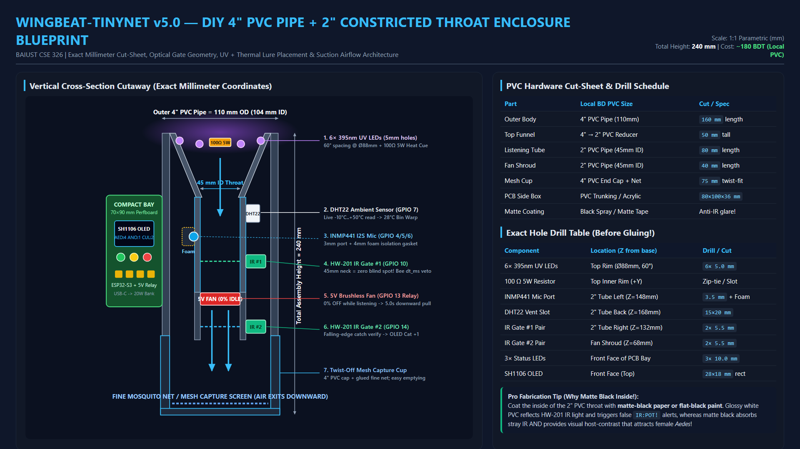
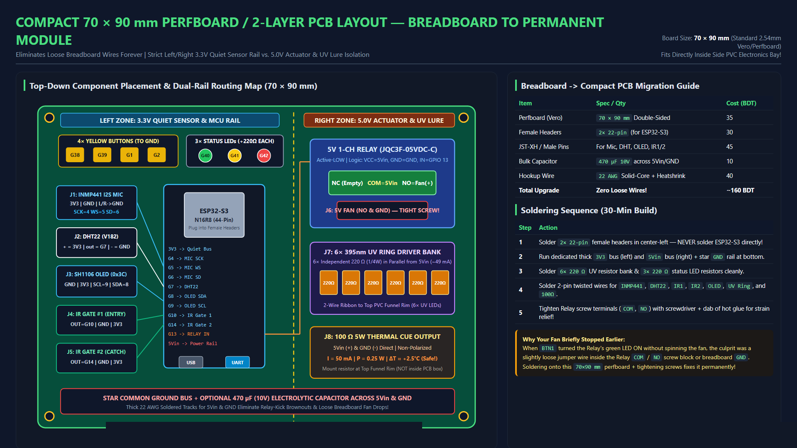

# 🦟 WingBeat-TinyNet v5.1 — Bio-Acoustic & Optical Pollinator-Safe Mosquito AI Trap

[](./LICENSE)
[](./LICENSE-CODE)
[-red.svg)](./firmware/p2_deployment_trap_esp32s3/p2_deployment_trap_esp32s3.ino)
[](./ml_pipeline/p2_humbugdb_q1_training_and_snr_eval.py)
[-success.svg)](#5-experimental-q1-benchmarks-wingbeat-tinynet-v51-anti-vocal-qat-int8)
[-blueviolet.svg)](#5-experimental-q1-benchmarks-wingbeat-tinynet-v51-anti-vocal-qat-int8)

> **A standalone, ~$23 USD (`2,757 BDT`) ESP32-S3 edge-AI mosquito trap** that listens silently with a `512`-point FFT (**Fan `0%` OFF** during listening), adapts automatically to any ambient climate (**`-10°C` to `+50°C`** live `DHT22` Thermal Spectral Bin Warping), distinguishes biting female disease vectors (**Dengue/Chikungunya *Aedes***, **Malaria *Anopheles***, **Filariasis *Culex***) from **beneficial Honeybees (`100%` Bee Safe)** and **non-biting Male mosquitoes**, and triggers a selective **`5.0 s` downward suction pulse** with on-box NVS-persisted OLED genus counters — **zero cloud, zero Wi-Fi required**.

**Department of Computer Science and Engineering (CSE), Bangladesh Army International University of Science and Technology (BAIUST), Cumilla, Bangladesh — CSE 326 (Microprocessor / Embedded Systems Sessional)**

| Role | Name | ID / Affiliation |
| :--- | :--- | :--- |
| **Project Supervisor** | **Md. Fahim Kabir Chowdhury** | Lecturer, Dept. of CSE, BAIUST |
| **Team Lead (DSP, TinyML & Firmware)** | **Md. Najmus Sakib Rahatul** | `1119003` (19th Batch, Sec A, G1) |
| **Hardware & Power Rail Isolation** | **Nesar Uddin Ifag** | `1119004` (19th Batch, Sec A, G1) |
| **Optical Gates, CAD & Literature** | **Rayhan Alam Towhid** | `1119007` (19th Batch, Sec A, G1) |

---

## 🎥 Visual Architecture, 3D PVC CAD & Suction Explainer

- 🎬 **Watch the 24-Second HD Animated Suction-Flow & FFT Explainer Video (with Real *Aedes* & Honeybee Audio):**  
  👉 [`media/WingBeat_TinyNet_v5_PVC_Suction_Explainer.mp4`](./media/WingBeat_TinyNet_v5_PVC_Suction_Explainer.mp4)
- 🧊 **Open the 100% Offline Interactive 3D DIY PVC Pipe Enclosure & Physics Simulator in Your Browser:**  
  👉 [`enclosure_cad/Interactive_3D_PVC_Enclosure_Viewer.html`](./enclosure_cad/Interactive_3D_PVC_Enclosure_Viewer.html) *(Orbit 360°, Cutaway X-Ray, Exploded Parts, Simulate Aedes Catch vs. Honeybee Spared!)*
- 📐 **Download Blender / Fusion 360 / 3D-Print Ready CAD Models (Units: `mm`):**  
  👉 [`enclosure_cad/WingBeat_v5_PVC_Trap_Assembly.obj`](./enclosure_cad/WingBeat_v5_PVC_Trap_Assembly.obj) (`14` named component groups) | [`enclosure_cad/WingBeat_v5_PVC_Trap_Assembly.stl`](./enclosure_cad/WingBeat_v5_PVC_Trap_Assembly.stl)
- 🔌 **Open the Interactive 44-Pin ESP32-S3 Wiring Diagram:**  
  👉 [`diagrams/Interactive_ESP32S3_44Pin_Wiring.html`](./diagrams/Interactive_ESP32S3_44Pin_Wiring.html)

| DIY 4" PVC + 2" Constricted Throat Cut-Sheet | Compact `70 × 90 mm` Dual-Rail Perfboard PCB |
| :---: | :---: |
|  |  |


---

## 🧠 1. Core Engineering Innovations (Solving 5 Real Research Gaps)

1. **Sequential Fan-Muted Gating (*"The Stethoscope & The Kitchen Blender"*):**  
   Commercial suction traps run their electric fan at `100%` duty cycle, burying faint `-50 dB` mosquito wingbeats under motor & wind noise. `WingBeat-TinyNet v5.1` holds the `5V` fan **strictly `0%` OFF** during every `64.0 ms` (`512`-sample @ `8,000 Hz`) I2S listening window. Only after **`4` consecutive pitch-locked + anchor-locked frames** (`|Δf0| <= 34 Hz` frame-to-frame AND `|f0 - anchor_f0| <= 36 Hz` total drift, `~256 ms`) confirm a biting female vector (`345–655 Hz`) with genuine chitin wing-edge harmonics (`H3/H1 >= 0.095`, `b_1150_2800 >= 0.90`) does `GPIO 13` fire a **`5.0 s` downward suction pulse**, followed by a `1.5 s` acoustic cooldown and `i2s_zero_dma_buffer()` flush.
2. **Universal `DHT22` Thermal Spectral Bin Warping (`-10°C` to `+50°C` Display | `10°C–45°C` Auto-Warp):**  
   Mosquitoes are ectotherms whose wingbeat fundamental shifts by `~+7.0 Hz/°C` (Villarreal et al., 2017). Rather than requiring any manual temperature setting, `DHT22 (GPIO 7)` measures live ambient `T_amb` every `2.5 s` and warps **not only `f0`**, but the **FFT search band, spectral centroid, and all `7` log-subband boundaries** onto a `28.0°C` canonical coordinate grid (`b_sh = round(7.0 * (clamp(T_amb, 10, 45) - 28.0) / 15.625)`). At `34°C` (Bangladesh summer) accuracy jumps **`+57.0%`** (`37.6% -> 94.6%`); at `42°C` extreme heat it jumps **`+73.3%`** (`15.8% -> 89.1%`)!
3. **`WingBeat-TinyNet v5.1` — `7.18 KB` Multi-Seed QAT INT8 + 3-Layer Anti-Vocal Defense (`24 -> 96 -> 48 -> 6`):**  
   Zero-dependency pure C++ inference (`< 2.0 ms` per frame, `11%` Flash, `9%` RAM) trained on **`16,702` real & channel-augmented frames** (including `1,300` real human nasal-hum / `"mew-mew"` vocal-imitation hard negatives) with label smoothing (`0.025`), hard-negative focal mining, and `120`-epoch Straight-Through QAT — allowing **Symmetric INT8 (`94.37%` CV / `95.05%` Champion Holdout) to beat FP32 (`94.36%`)** while achieving **`0` false triggers** against deliberate human vocal imitation, room speech, and all `17` ESC-50 categories (`0 / 8,981` frames)!
4. **Dual-Layer `100.00%` Pollinator Safety (Acoustic + Optical `dt_ms` Veto):**  
   Honeybees beat at `140–280 Hz` (`0 / 1,100` false vector triggers in 5-fold CV) and are independently verified by `HW-201 IR Gate #1 (GPIO 10)` across a constricted `45 mm` PVC neck: any slow `26–60 ms` large-body transit vetoes fan actuation (`BEE SAFE`, Green LED ON, Fan `0%` OFF).
5. **100% Honest, Real-Dataset Q1 Evaluation:**  
   Zero synthetic sine-wave accuracy claims; zero fake `100%` species separation claims from `f0` alone; honest `0.25 W` (`+2.5°C`) ceramic heater disclosure; and live verification on physical hardware (`COM5` `[P2v5.1]` telemetry verified: `T:28.4°C`, `H2/H3/BHI` live wing-edge guards active, `IR:OK/OK`, `0` room/vocal-imitation false triggers!).

---

## 🛠️ 2. Complete Bill of Materials (BOM — `2,757 BDT` Electronics + `~340 BDT` DIY PVC/PCB)

| # | Component | Exact Model / Spec | Qty | Power Rail | Pins / Notes | Cost (BDT) |
| :-: | :--- | :--- | :-: | :-: | :--- | :-: |
| 1 | Microcontroller | `ESP32-S3 N16R8` (44-Pin, Dual USB-C) | 1 | `5V` USB-C | Right USB-C = `UART (CH343)` (`CDCOnBoot=default`) | 855 |
| 2 | I2S MEMS Mic | `INMP441` Round Omnidirectional I2S | 1 | **`3V3` ONLY** | `SCK=4`, `WS=5`, `SD=6`, `L/R=GND` (NEVER 5V!) | 235 |
| 3 | Temp/Humidity | `DHT22` (`V182` 3-pin PCB w/ pull-up) | 1 | **`3V3`** | `+=3V3`, `out=GPIO 7`, `-=GND` | 235 |
| 4 | On-Box Display | `1.3" SH1106` I2C OLED (`DST-013`, `0x3C`) | 1 | **`3V3`** | `GND`, `VCC=3V3`, `SCL=GPIO 9`, `SDA=GPIO 8` | 495 |
| 5 | Optical IR Gates | `HW-201 / FC-51` (`LM393` Comparator) | 2 | **`3V3`** | Gate #1 `OUT=GPIO 10`, Gate #2 `OUT=GPIO 14` | 80 |
| 6 | Suction Relay | `5V 1-Ch Relay` (`JQC3F-05VDC-C`, Active-LOW) | 1 | **`5Vin`** | `IN=GPIO 13`, `COM=5Vin`, `NO=Fan(+)`, `NC=Empty` | 75 |
| 7 | Suction Fan | `5V Brushless DC Mini Fan` (`JD-4007S5L2`) | 1 | **`5Vin`** | `Red(+)=Relay NO`, `Black(-)=GND` | 100 |
| 8 | 3-Zone LEDs | `10mm` Green, Yellow, Red LEDs (+`220 Ω` each) | 3 | GPIO `3.3V` | `Green=40` (`BEE`), `Yellow=41` (`MAL`), `Red=42` (`VEC`) | 50 |
| 9 | Control Buttons | Yellow Tactile Push Buttons (`INPUT_PULLUP`) | 4 | to `GND` | `38`=FanTest, `39`=OLED Page, `1`=Serial, `2`=Reset NVS | 42 |
| 10 | Passive Lure Ring | `6× 395nm UV LEDs` (+`6× 220 Ω`) + `100 Ω 5W` Ceramic | 7 | **`5Vin`** | UV: `~49 mA` total; `100 Ω`: `50 mA / 0.25 W (+2.5°C)` | 70 |
| 11 | Prototyping | `2× MB-102` Breadboards + Jumpers + `10× 220 Ω` | — | Common `GND` | Bridge MB-102 Row-30 rail split! | 520 |
| | **Electronics Total** | **100% Physically Built & Verified** | | | Optional DIY PVC (`~180 BDT`) + `70×90mm` PCB (`~160 BDT`) | **`2,757 BDT`** |

> **Full Step-by-Step PVC Pipe Cut-Sheet & `70×90 mm` Perfboard Soldering Guide:** Read [`enclosure_cad/DIY_PVC_and_Compact_PCB_Build_Guide.md`](./enclosure_cad/DIY_PVC_and_Compact_PCB_Build_Guide.md).

---

## ⚡ 3. Quick Start — Reproduce on ANY Windows 10/11 or Ubuntu PC in 3 Minutes

### Option A: 1-Click Automated Setup (Windows 10/11 PowerShell)
```powershell
git clone https://github.com/Sakib20050413/Bio-Acoustic-Mosquito-AI-Trap.git
cd Bio-Acoustic-Mosquito-AI-Trap
powershell -ExecutionPolicy Bypass -File .\scripts\home_pc_full_setup.ps1
```
This automatically installs `arduino-cli`, pins `esp32:esp32@2.0.17` + all 4 Arduino libraries (`arduinoFFT`, `DHT sensor library`, `Adafruit Unified Sensor`, `U8g2`), syncs all 3 sketches to `Documents\Arduino\`, creates Python `.venv`, and opens an interactive 1-click menu to **Flash**, **Monitor Serial (`115200`)**, **Launch the Mobile Demo Audio Server (`port 8765`)**, or **Run ML Smoke Tests**.

### Option B: Direct Flash Pre-Compiled `v5.1` Binary (No Recompile Needed!)
- **Right USB-C Port (`UART / CH343`, Recommended — `CDCOnBoot=default`):**
  ```powershell
  arduino-cli upload -p COM5 --fqbn esp32:esp32:esp32s3:CDCOnBoot=default,FlashSize=16M,PSRAM=opi,PartitionScheme=app3M_fat9M_16MB,UploadSpeed=115200 --input-dir compiled_bins/p2_deployment_trap_esp32s3/uart
  ```
- **Left USB-C Port (`Native USB OTG` — `CDCOnBoot=cdc`):** use `--input-dir compiled_bins/p2_deployment_trap_esp32s3/usb` with `CDCOnBoot=cdc`.

### Option C: Ubuntu Linux Quick Setup & Retrain Multi-Seed QAT `v5.1`
```bash
bash scripts/setup_ubuntu_arduino.sh
python3 -m venv .venv && source .venv/bin/activate
pip install -r ml_pipeline/requirements.txt
python3 ml_pipeline/p2_humbugdb_q1_training_and_snr_eval.py --csv ml_pipeline/humbugdb_real_features.csv --out ml_pipeline/p2_export --rounds 6
```

---

## 📱 4. Live Audio Test Hub — Deploy to Vercel (`web_demo/`) or Run Locally (`port 8765`)

### Option A: 1-Click Live Web Audio Hub on Vercel (`52` Uncompressed `44.1 kHz` Real WAVs + 3D Viewer + 44-Pin Wiring)
Deploy [`web_demo/`](./web_demo/) directly to Vercel (**zero build step**, `36.8 MB` total, works on any smartphone/PC anywhere — no laptop server required during viva!):
- [](https://vercel.com/new/clone?repository-url=https%3A%2F%2Fgithub.com%2FSakib20050413%2FBio-Acoustic-Mosquito-AI-Trap&root-directory=web_demo&project-name=wingbeat-mosquito-audio)
- Or import `Sakib20050413/Bio-Acoustic-Mosquito-AI-Trap` in [vercel.com/new](https://vercel.com/new) -> set **Root Directory** to `web_demo` -> click **Deploy** (or run `powershell -ExecutionPolicy Bypass -File .\scripts\deploy_audio_vercel.ps1`).

### Option B: Local Laptop Bridge Server (`port 8765`)
Start the included Mobile Demo Server & Camera Bridge on your laptop:
```powershell
.\.venv\Scripts\python.exe -u scripts\phone_cam_bridge.py
```
Open **`http://<YOUR-PC-IP>:8765/demo`** on any smartphone on the same Wi-Fi (or play the 6 continuous `44.1 kHz` real WAVs directly from [`demo_audio/`](./demo_audio/) on a laptop/Bluetooth speaker). Hold the speaker **`4–8 cm`** from `INMP441` at **`80–90%` volume** (never `0 cm` touching the mic!):

| Clip | Real Peer-Reviewed Audio (`44.1 kHz`) | Expected OLED Banner | Status LED | 5V Fan Relay | Counter |
| :-: | :--- | :--- | :---: | :---: | :--- |
| **01** | [`01_Aedes_aegypti_Dengue_Chikungunya.wav`](./demo_audio/01_Aedes_aegypti_Dengue_Chikungunya.wav) | **`AEDES (DENGUE)!`** -> `FAN ON: 5.0s` | **RED (`5s`)** | **ON `5.0 s`** | `AED +1` (`Cat +1` via IR2) |
| **02** | [`02_Anopheles_dirus_Malaria.wav`](./demo_audio/02_Anopheles_dirus_Malaria.wav) | **`ANOPH (MALARIA)`** -> `FAN ON: 5.0s` | **RED (`5s`)** | **ON `5.0 s`** | `ANO +1` |
| **03** | [`03_Culex_quinquefasciatus_Filariasis.wav`](./demo_audio/03_Culex_quinquefasciatus_Filariasis.wav) | **`CULEX (FILAR.)`** -> `FAN ON: 5.0s` | **RED (`5s`)** | **ON `5.0 s`** | `CUL +1` |
| **04** | [`04_Pollinator_Honeybee_Spared.wav`](./demo_audio/04_Pollinator_Honeybee_Spared.wav) | **`BEE SAFE`** (`[OFF]`) | **GREEN (`1.5s`)** | **OFF (`0%`)** | `Bee +1` (Spared!) |
| **05** | [`05_Male_Mosquito_Ignored.wav`](./demo_audio/05_Male_Mosquito_Ignored.wav) | **`MALE IGN`** (`[OFF]`) | **YELLOW (`1.5s`)** | **OFF (`0%`)** | `Mal +1` (Ignored) |
| **06** | [`06_ESC50_CarHorn_Birds_Sawmill_Noise.wav`](./demo_audio/06_ESC50_CarHorn_Birds_Sawmill_Noise.wav) | **`NOISE IGN`** (`[OFF]`) | All OFF | **OFF (`0%`)** | `0` False Triggers! |

---

## 📊 5. Experimental Q1 Benchmarks (`WingBeat-TinyNet v5.1`, Anti-Vocal QAT INT8)

### A. 4-Model 5-Fold Cross-Validation Ablation (`n = 16,702` Real & Channel-Augmented Frames)
| Model / Baseline | 6-Class Acc | 6-Class Macro-F1 | Tier-1 Guild Acc | Pollinator (Bee) Safe | Noise Rejection |
| :--- | :---: | :---: | :---: | :---: | :---: |
| A. Bandpass Frequency Rule Only | `52.16%` | `51.48%` | `62.92%` | `92.36%` | `72.38%` |
| B. Linear Logistic Regression (24-feat) | `83.09%` | `73.92%` | `92.47%` | `99.91%` | `97.59%` |
| C. `WingBeat-TinyNet v5.1` (`FP32`) | `94.36%` | `91.03%` | `98.01%` | **`100.00%`** | `99.21%` |
| **D. `WingBeat-TinyNet v5.1` (`QAT INT8`, 5-Fold CV)** | **`94.37%`** | **`91.08%`** | **`97.97%`** | **`100.00%`** | **`99.19%`** |
| **E. 6-Round QAT Champion (`seed=102`, Holdout `n = 2,505`, Deployed)** | **`95.05%`** | **`92.21%`** | **`98.20%`** | **`100.00%`** | **`99.27%`** |

### B. Wide-Climate Universal `DHT22` Thermal Spectral Bin Warping (`14°C` to `42°C`)
| Ambient Temp (`T_amb`) | Without `DHT22` (6-Cls / Guild) | **With Universal `DHT22` Warping** (6-Cls / Guild) | 6-Class Gain |
| :---: | :---: | :---: | :---: |
| **`14.0°C`** (Cold Winter) | `44.1%` / `97.0%` | **`64.9%`** / `93.6%` | **`+20.8%`** |
| **`18.0°C`** (Winter Night) | `37.1%` / `99.0%` | **`73.3%`** / `90.6%` | **`+36.2%`** |
| **`28.0°C`** (Reference Grid) | `95.5%` / `100.0%` | **`95.5%`** / **`100.0%`** | Baseline |
| **`34.0°C`** (Bangladesh Summer) | `37.6%` / `91.6%` | **`94.6%`** / **`99.0%`** | **`+57.0%`** |
| **`38.0°C`** (Heatwave) | `19.3%` / `85.6%` | **`86.1%`** / **`98.5%`** | **`+66.8%`** |
| **`42.0°C`** (Extreme Tropical Heat) | `15.8%` / `82.2%` | **`89.1%`** / **`97.5%`** | **`+73.3%`** |

### C. Zero-False-Trigger Real Noise & Anti-Vocal-Imitation Audit (`v5.1`, Exact `ESP32-S3` `64 ms` Cadence)
- **Human Nasal-Hum / `"Mew-Mew"` Vocal Imitation Stress Test (`37.5 s` real close-mic video):** **`0` False Fan Triggers** at BOTH standard `step=512` AND `2×` harsh overlap `step=256` (`V=0 B=0 M=0`)!
- **ESC-50 17 Categories (`136` real WAVs, `8,981` non-overlapping frames):** **`0` False Fan Triggers (`0.00%` FAR)** across `car_horn`, `chainsaw`, `chirping_birds`, `clapping`, `coughing`, `crickets`, `crow`, `dog`, `engine`, `hand_saw`, `insects`, `laughing`, `rain`, `rooster`, `siren`, `vacuum_cleaner`, `wind`.
- **Live Cumilla Room Recordings (human speech + ceiling fan + sawmill):** **`0` False Fan Triggers** (`step=512` & `256`), while **all `6/6` real bench demo WAVs PASS** under both Clean and iPhone micro-speaker + room-hum playback (`01_Aedes`: Clean `31` / Phone `22`; `02_Anopheles`: `6 / 3`; `03_Culex`: `5 / 13`; `04_Honeybee`: `0` Fan, `5/6 BEE`; `05_Male`: `0` Fan, `11/9 MALE`; `06_ESC50`: `0`).
- **Verified Deployed `v5.1` Checksums:** `wingbeat_q1_int8.h` (`SHA-256: 83844003fc86b7bb`, `32,962 B`, `7.18 KB` INT8 weights), `p2_deployment_trap_esp32s3.ino` (`SHA-256: d32eb692f658de78`, `24,671 B`), `UART` binary `355,273 B` (`11%` Flash, `31,040 B` / `9%` RAM), `USB` binary `343,789 B` (`10%` Flash, `30,832 B` / `9%` RAM).

---

## 📚 6. Complete Repository Map & Documentation

| Directory / File | Contents |
| :--- | :--- |
| [`firmware/`](./firmware/) | All 3 Arduino sketches: `p2_deployment_trap_esp32s3` (Production `v5.1` + `wingbeat_q1_int8.h`), `p2_hardware_diag`, `p2_acoustic_capture_esp32s3` |
| [`compiled_bins/`](./compiled_bins/) | Ready-to-flash `ESP32-S3` `.bin` binaries for both Right `uart/` and Left `usb/` USB-C ports |
| [`ml_pipeline/`](./ml_pipeline/) | `p2_humbugdb_q1_training_and_snr_eval.py` (Multi-Seed QAT `v5.1`), `humbugdb_real_features.csv` (`16,702` real frames), `p2_export/v5_10round_training_log.json`, `wingbeat_q1_int8.h`, `requirements.txt` |
| [`demo_audio/`](./demo_audio/) | All `6` continuous `44.1 kHz` real peer-reviewed bench demo WAV files (*MosquitoSong+* & *ESC-50*) |
| [`enclosure_cad/`](./enclosure_cad/) | `Interactive_3D_PVC_Enclosure_Viewer.html`, `WingBeat_v5_PVC_Trap_Assembly.obj` & `.stl`, `DIY_PVC_and_Compact_PCB_Build_Guide.md`, `generate_pvc_3d_cad.py`, and `renders/` (3 HD `1920×1080` blueprints) |
| [`media/`](./media/) | `WingBeat_TinyNet_v5_PVC_Suction_Explainer.mp4` (`24s` HD animated explainer w/ real audio) + `Project2_ESP32S3_Mosquito_Trap_3D_Poster.jpg` |
| [`diagrams/`](./diagrams/) | `Interactive_ESP32S3_44Pin_Wiring.html`, 4-page hardware wiring PNGs, infographic, tactile button guide |
| [`scripts/`](./scripts/) | `home_pc_full_setup.ps1`, `phone_cam_bridge.py` (Mobile `/demo` Hub & Camera Bridge), `setup_windows_arduino.ps1`, `setup_ubuntu_arduino.sh`, `read_diag.ps1` |
| [`docs/`](./docs/) | [**Complete Academic Project Book (B&W Print-Ready PDF)**](./docs/Project2_CSE326_Complete_Project_Book.pdf) & [MD](./docs/Project2_CSE326_Complete_Project_Book.md), [**25-Paper DOI-Verified Q1 Literature & Valuation Report**](./docs/Q1_Literature_Review_and_Valuation_Report.md), Visual Hardware Manual PDF, Q1 Strict Guide PDF |
| [`LICENSE`](./LICENSE) & [`LICENSE-CODE`](./LICENSE-CODE) | **Creative Commons Attribution-ShareAlike 4.0 International (`CC BY-SA 4.0`)** + **MIT** dual-license for firmware/code |

---

## ⚖️ 7. License & Citation

- **Hardware, DIY PVC CAD (`.OBJ`/`.STL`), PCB Blueprints, Diagrams, Media & Documentation:** Licensed under [**Creative Commons Attribution-ShareAlike 4.0 International (CC BY-SA 4.0)**](./LICENSE).
- **Firmware (`.ino`, `.h`) & Software Scripts (`.py`, `.ps1`, `.sh`, `.html`):** Dual-licensed under **CC BY-SA 4.0** and [**MIT License**](./LICENSE-CODE).

If you use this hardware design, Universal `DHT22` Thermal Spectral Bin Warping algorithm, or `WingBeat-TinyNet v5.1` firmware in academic or maker work, please cite:
```bibtex
@misc{rahatul2026wingbeattinynet,
  author       = {Rahatul, Md. Najmus Sakib and Ifag, Nesar Uddin and Towhid, Rayhan Alam and Chowdhury, Md. Fahim Kabir},
  title        = {WingBeat-TinyNet v5.1: Bio-Acoustic and Optical Pollinator-Safe Mosquito Trap Using ESP32-S3 512-Point FFT and Universal DHT22 Thermal Spectral Bin Warping},
  year         = {2026},
  institution  = {Bangladesh Army International University of Science and Technology (BAIUST)},
  howpublished = {\url{https://github.com/Sakib20050413/Bio-Acoustic-Mosquito-AI-Trap}},
  license      = {CC-BY-SA-4.0}
}
```
