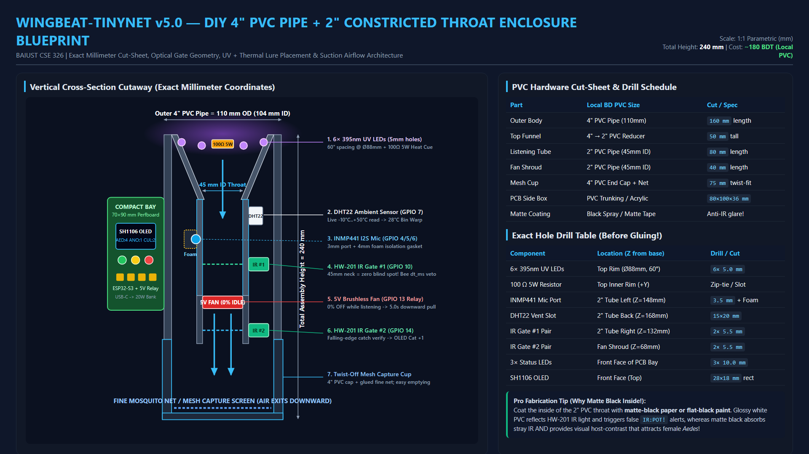
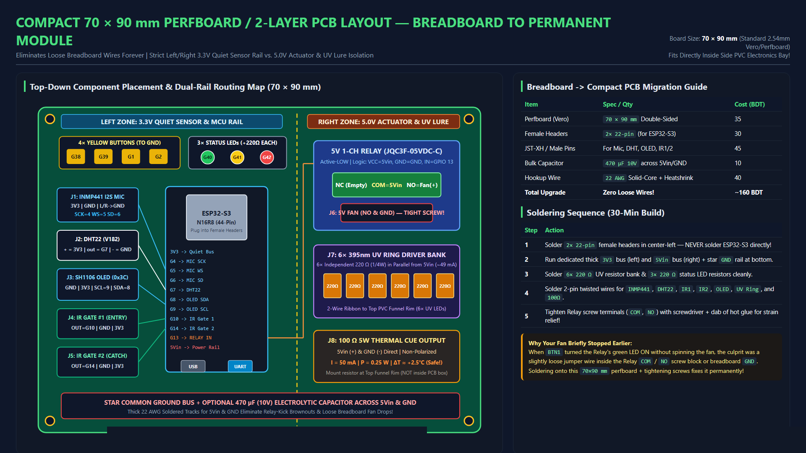
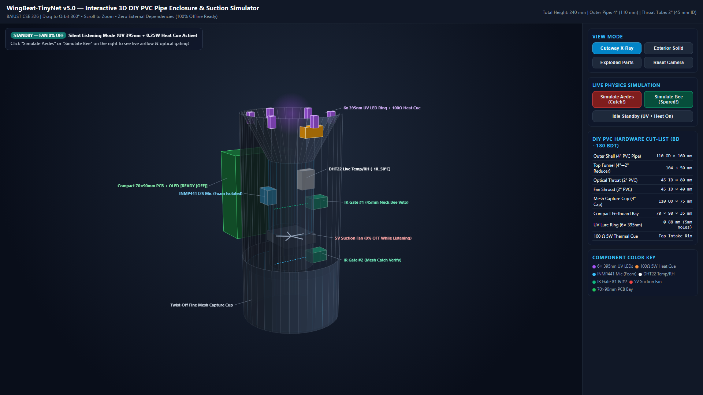

# DIY Compact PVC Pipe Enclosure & 70 × 90 mm Perfboard PCB Fabrication Guide

**WingBeat-TinyNet v5.0 — From Open Breadboard Prototype to Rugged, Pocket-Compact Smart Trap**

> **Interactive 3D Viewer:** Open [`Interactive_3D_PVC_Enclosure_Viewer.html`](./Interactive_3D_PVC_Enclosure_Viewer.html) in any desktop/mobile browser (100% offline!) to orbit 360°, toggle **Cutaway X-Ray** / **Exploded Parts**, and simulate **Aedes Capture** vs. **Pollinator Bee Safe**.  
> **3D CAD Files (Blender / Fusion 360 / 3D Print):** [`WingBeat_v5_PVC_Trap_Assembly.obj`](./WingBeat_v5_PVC_Trap_Assembly.obj) (`14` named component groups) & [`WingBeat_v5_PVC_Trap_Assembly.stl`](./WingBeat_v5_PVC_Trap_Assembly.stl).

---

## 1. Why a Constricted 2-inch (`45 mm` ID) PVC Throat Tube Is Mandatory

A wide `100–150 mm` box fails for two physical reasons:
1. **`HW-201 / FC-51` (`LM393`) IR Gate Range Limit:** Inexpensive reflective IR obstacle modules reliably detect small dark insects only within `1.5–4.5 cm`. Narrowing the listening throat to a standard **2-inch (`45 mm` internal diameter) PVC pipe** completely eliminates the center blind spot so every passing insect cleanly crosses Gate #1 (`GPIO 10`, entry `dt_ms` Bee Veto) and Gate #2 (`GPIO 14`, mesh catch verification).
2. **Higher Acoustic SNR & Suction Velocity:** Concentrating the flight path inside a `45 mm` tube keeps incoming mosquitoes within `2–4 cm` of the foam-isolated `INMP441` microphone AND triples downward suction airspeed when the `40 mm` `5V` brushless fan fires its `5.0 s` capture pulse!

---

## 2. Local Bangladesh Hardware-Store Shopping List (`~340 BDT` Total Upgrade)

### A. DIY PVC Pipe Enclosure (`~180 BDT`)
| Part | Local Hardware Store Spec | Exact Cut Length | Qty | Est. Cost (BDT) |
| :--- | :--- | :--- | :-: | :-: |
| **Outer Body** | `4-inch` (`110 mm` OD / `104 mm` ID) PVC Pipe | **`160 mm`** | 1 | 60 |
| **Top Intake Funnel** | `4" -> 2"` PVC Pipe Reducer Coupling | `50 mm` (standard) | 1 | 55 |
| **Optical Throat Tube** | `2-inch` (`50 mm` OD / `45 mm` ID) PVC Pipe | **`80 mm`** (listening) + **`40 mm`** (fan shroud) | 1 | 30 |
| **Twist-Off Capture Cup** | `4-inch` PVC End Cap + Fine Mosquito Net (`15×15 cm`) | `75 mm` twist-fit base | 1 | 35 |
| **Interior Coating** | Matte-Black Chart Paper or Flat-Black Spray Paint | Line inside of `2"` throat & funnel | — | *(optional)* |

> **CRITICAL OPTICS TIP:** Never leave the inside of the `2"` PVC throat glossy white! Glossy PVC bounces IR light back into `HW-201`, causing false `IR:POT!` readings. Lining the inner wall with **matte-black paper or flat-black tape** stops stray IR glare AND adds dark visual host-contrast that attracts female *Aedes*!

### B. Compact `70 × 90 mm` Solderable Perfboard Upgrade (`~160 BDT`)
| Part | Spec | Purpose | Est. Cost (BDT) |
| :--- | :--- | :--- | :-: |
| **Double-Sided Perfboard** | `70 × 90 mm` (`2.54 mm` pitch) | Replaces 2 bulky breadboards -> fits side PVC bay | 35 |
| **Female Pin Headers** | `2× 22-pin` (`2.54 mm`) | Removable socket for `ESP32-S3 N16R8` (never solder MCU!) | 30 |
| **JST-XH / Male Headers** | `2-pin`, `3-pin`, `4-pin` sets | Clean detachable harnesses to Mic, DHT22, OLED, IR1/2, Fan | 45 |
| **Bulk Capacitor** | `470 µF 10V` Electrolytic | Placed across `5Vin` & `GND` to absorb `5V` relay inrush spike | 10 |
| **22 AWG Solid Wire + Hot Glue** | Strain relief on Relay screws | Permanently fixes loose fan wire dropouts! | 40 |

---

## 3. Exact Millimeter Cut & Drill Schedule (Step-by-Step Fabrication)

1. **Cut the PVC Pipes (Hacksaw + Sandpaper):**
   - Cut **`4"` PVC Pipe** to **`160 mm`** (outer cylindrical shell).
   - Cut **`2"` PVC Pipe** into two pieces: **`80 mm`** (upper listening throat) and **`40 mm`** (lower fan shroud below the `40 mm` fan).
2. **Drill All Sensor & LED Holes BEFORE Gluing:**
   - **Top Rim (`4"` Funnel Lip, `Ø 88 mm` circle):** Drill **`6× 5.0 mm`** holes evenly spaced every `60°` for the `6× 395 nm UV LEDs`. Angle them slightly inward (`~15°`) so violet light illuminates the top funnel entrance without blinding `IR Gate #1`.
   - **`100 Ω 5W` Ceramic Thermal Cue:** Zip-tie or mount directly inside the top intake lip (`+Y` side, `Z = 220 mm`) with airflow clearance — **never mount inside the sealed PCB box**.
   - **`INMP441` Mic Port (`2"` Throat, Left `-X`, `Z = 148 mm`):** Drill a **`3.5 mm`** acoustic port. Glue a **`4 mm` thick open-cell foam gasket** around the hole on the outside of the `2"` tube and press the `INMP441` face flush against the foam (decouples PVC vibrations from the MEMS diaphragm!).
   - **`DHT22` Vent (`2"` Throat, Back `+Y`, `Z = 168 mm`):** Cut a small `15 × 20 mm` notch so the white sensor grid samples real ambient air inside the intake throat.
   - **`HW-201 IR Gate #1` (`2"` Throat, Right `+X`, `Z = 132 mm`):** Drill two **`5.5 mm`** holes (`6 mm` center-to-center) so the clear IR emitter & dark photodiode peek cleanly into the `45 mm` matte-black throat.
   - **`5V 40×40 mm` Brushless Fan (`Z = 92–102 mm`):** Sandwich the fan horizontally between the `80 mm` upper throat and `40 mm` lower shroud with airflow arrows **pointing DOWNWARD** into the capture cup! Seal the perimeter gap with electrical tape or hot glue so 100% of suction pulls through the throat.
   - **`HW-201 IR Gate #2` (Lower Fan Shroud, Right `+X`, `Z = 68 mm`):** Drill two **`5.5 mm`** holes right below the fan exhaust to detect falling mosquitoes entering the mesh cup (`Cat +1`).
3. **Build the Twist-Off Mesh Capture Cup (`Z = 0–75 mm`):**
   - Cut a **`70 mm` circular ventilation hole** in the bottom of the `4"` PVC End Cap and glue **fine mosquito netting (or organza mesh)** tautly across the opening. Exhaust air escapes freely downward while captured mosquitoes remain safely trapped inside! Slip-fit (do NOT glue!) the cup onto the bottom of the `4"` outer shell so you can twist it off for inspection/emptying.

---

## 4. Compact `70 × 90 mm` Perfboard / PCB Soldering Blueprint

### Strict Dual-Rail Isolation Rules (Zero Noise, Zero Loose Fan Drops)
- **Left Zone (`3.3V` Quiet Sensor & MCU Rail):** Mount `ESP32-S3 N16R8` in `2× 22-pin` female headers; connect `INMP441 (GPIO 4/5/6, L/R=GND)`, `DHT22 (GPIO 7)`, `SH1106 OLED (GPIO 8/9)`, `IR Gate #1 (GPIO 10)`, `IR Gate #2 (GPIO 14)`, `3× 10mm Status LEDs (+220 Ω each, GPIO 40/41/42)`, and `4× Yellow Buttons (GPIO 38/39/1/2 to GND)`.
- **Right Zone (`5.0V` Actuator & Lure Rail):** Mount the `5V 1-Channel Relay (JQC3F-05VDC-C)` (`IN = GPIO 13`, `VCC = 5Vin`, `COM = 5Vin`, `NO = Fan(+)`, `Fan(-) = GND`), the **`6× 220 Ω` parallel UV LED resistor bank**, and the 2-wire terminal to the **`100 Ω 5W` ceramic thermal resistor**.
- **Permanent Loose-Fan Fix:** Strip `6 mm` of insulation on the `COM` and `NO` fan wires, twist tightly, tin lightly with solder, tighten the green relay screw terminals firmly with a Philips screwdriver, and add a small drop of hot glue over the wire collar so vibrations can never loosen them again!

